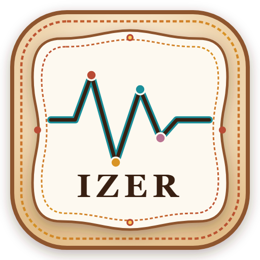

# IZER

**Indian Papercraft Parametric EQ** for the JadeAudio JA11.

IZER is a desktop studio for drawing a five-band curve, saving presets, importing Equalizer APO / JSON, and sending the curve to a JA11 over USB. The window is frameless on Windows: the search field, navigation, and minimize / maximize / close controls sit in the app itself.



## Download

| Platform | What you get | Link |
| --- | --- | --- |
| Windows 10 / 11 | Setup wizard (NSIS) and a portable `.exe` | [Latest Windows release](https://github.com/SatyaKesavaKorlapati/IZER/releases/latest) |
| macOS | Disk image and zip, built on a Mac | [Latest macOS release](https://github.com/SatyaKesavaKorlapati/IZER/releases/latest) |
| iPhone / iPad | Not available | WebHID and this Electron shell do not run on iOS. Use the Windows or Mac app with the JA11 plugged into that computer. |

The Windows installer is built on this project with `npm run bundle:win`. It is not a one-click installer: you can choose the folder, and it adds a Start Menu shortcut and a desktop shortcut named **IZER**. The installed app lives under `%LocalAppData%\Programs\IZER`.

A Mac `.dmg` has to be produced on macOS (`npm run bundle:mac`). This repository does not ship an iOS binary, because the JA11 link uses WebHID.

## What it does

- **Studio** — graph, five bands, A/B, static and live slots, lock, copy, paste, reset, read from the DAC, level match, and factory match.
- **Presets** — built-in curves and curves you save on this computer.
- **Import** — Equalizer APO and JSON.
- **Device** — pick a paired JA11 or another HID device, connect, and unpair.
- **Settings** — appearance (including PAPEIN dark mode and the darkness slider), graph colors, tile width, and Google Drive backup through rclone on this PC.
- **Google Drive** — the installed app runs a local API on `127.0.0.1:1423`. Presets upload to `izer_gdrive:izer/Presets/`.

The JA11 vendor id is `0x2972` (products `0x0101` and `0x0102`).

## PAPEIN dark mode

Dark mode has two sliders that share one value:

- **Darkness**, next to the Dark switch
- **Darkness level**, in Settings

`0` keeps the charcoal sheet and the landscape. `100` pushes the background, cards, graph, and landscape toward black. The choice is stored on this computer.

## Develop

```bash
npm install
npm run dev
```

Vite serves the UI, usually at `http://127.0.0.1:1420`. The Drive API is mounted on that dev server.

```bash
npm run check
npm run build
npm run electron:start
```

`npm run fast:build` typechecks, bundles the Drive API, packs `app.asar`, and updates the installed Windows copy.

## Installer

```bash
npm run bundle:win    # Windows setup + portable
npm run bundle:mac    # macOS dmg + zip (run on a Mac)
npm run bundle:linux  # AppImage + deb
```

Windows artifacts:

- `release/IZER Setup 1.0.0.exe` — installer
- `release/IZER 1.0.0.exe` — portable build

## Google Drive backup

Install [rclone](https://rclone.org/) and put it on `PATH`. In Settings, connect Google Drive, finish the browser sign-in, then press **Check connection**. Uploads keep running if you switch tabs.

## Author

[satyakesavakorlapati](https://github.com/SatyaKesavaKorlapati) · korlapatisatyakesava@gmail.com
